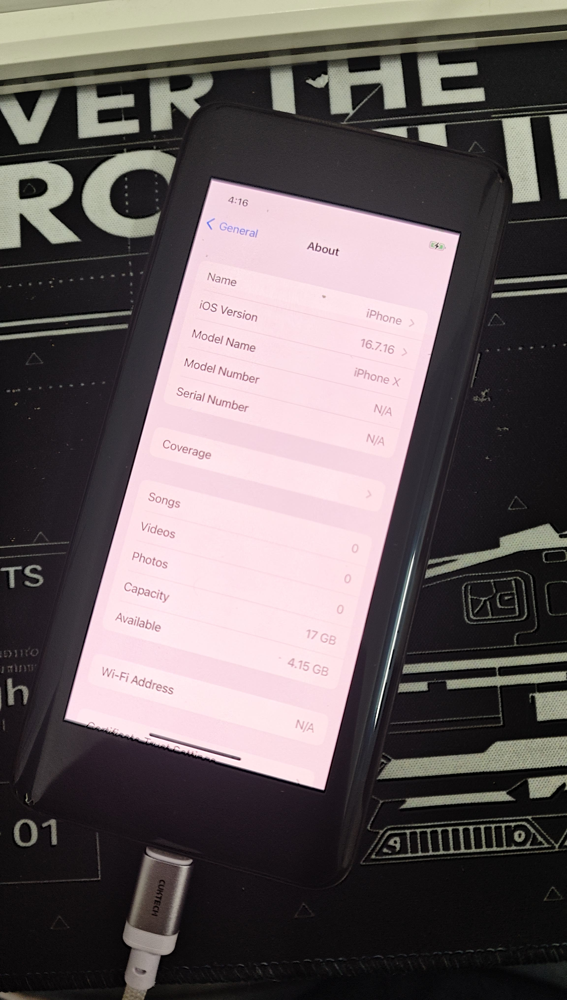

# ios-guacamole

**在一加 7 Pro 上运行 Apple iOS 16。**

这是 [ios-sweet](https://github.com/dipa-studio/ios-sweet)（在小米红米 Note 10 Pro
上跑 XNU）的移植版本，目标机是一加 7 Pro（`guacamole`，高通 SM8150 / 骁龙 855，
Adreno 640）。Apple 开源的 XNU 内核（xnu-8796，iOS 16 世代）从**原厂引导程序**
启动，运行**未经修改的 iPhone X iOS 16.7.16 (20H392) 用户态**：launchd、系统守护
进程、backboardd、SpringBoard 以及系统自带应用。

截至 **2026-10-20**，手机可以启动到 **iOS 主屏幕**：SpringBoard 正常渲染、应用可以
打开、触摸屏可用。渲染完全由 CPU 完成，**没有 GPU 驱动**。



*一加 7 Pro 上的 iOS 16.7.16：关于本机显示 "iPhone X"、容量 17 GB、可用 4.15 GB。
画面采用信箱模式（1125x2436 画布居中显示在 1440x3120 面板上）。*

[English README](README.md)

> 实验性项目，不是能日常使用的手机系统。很多功能缺失或被桩掉（见下），Apple 的
> 安全模型基本处于关闭状态。它写入 `userdata` 分区，因此会**清空 Android 数据**。

## 已实现

| 模块 | 状态 |
| --- | --- |
| 启动 | 原厂 OnePlus ABL → `fastboot boot` 我们的 shim → XNU。不向 boot 分区写入任何东西 |
| CPU | 通过 PSCI 启动全部 8 核（`cpus=8`），16K 页，GICv3 中断，19.2 MHz 计时器 |
| 内存 | `0xc0000000` 起 3 GiB（配置也提供 `0x180000000` 起的 4 GiB 高地址段） |
| 存储 | 自己的 UFS 主控驱动（`ufshc@1d84000`）；iOS 根文件系统是 `userdata` 里的日志式 HFS+ 卷，可读写 |
| iOS 用户态 | 真实的 iPhone X 16.7.16 根文件系统与 dyld 共享缓存；launchd 与系统守护进程正常运行 |
| 显示 | 内核 IOSurface + IOMobileFramebuffer（`AppleCLCD`）服务；CoreAnimation 软件渲染；帧以 30 Hz 拷贝到 ABL 的 splash framebuffer。以 iPhone X 面板（1125x2436）呈现，居中信箱显示在 1440x3120 面板上 |
| 图形界面 | backboardd、SpringBoard、主屏幕、应用 |
| 触摸 | 三星 S6SY761，GENI SE17 上 I²C 地址 `0x48`，使用 **GPIO 位翻转 I²C**（该机的 SE FIFO 接口被熔断）；TLMM 四 tile GPIO 寻址；1.8 V 与 `ldoa17`（3008 mV）经 RPMh 使能 |
| 设备身份 | iPhone X（`iPhone10,3` / `D22AP`）：无 Home 键、手势 UI |
| 激活 | mobileactivationd 的原生 "Hactivation" 本地分支，由设备树的安全状态属性选择；不连接 Apple 服务器 |

## 尚未实现

- **没有 GPU。** Adreno 640 处于空闲状态；CoreAnimation 走软件渲染（大约 20~30 fps）。
  迁移计划见[路线图](#路线图)。
- **没有 Wi-Fi、蓝牙、蜂窝、音频、相机、传感器、GPS、SEP / Face ID。** 相关守护进程
  会启动后失败或反复重启。
- **设置向导会卡住**：在「不传输 App 与数据」之后停在无文字的转圈界面。目前使用的
  根镜像是跳过设置向导的版本，所以会直接进入主屏幕。
- **应用很少。** 镜像只有系统卷里的内容，没有 App Store，也没有 Apple ID。
- **启动慢：** Apple logo 大约停留 4~5 分钟。
- **安全机制关闭：** AMFI 与沙箱策略宽松，AppleKeyStore 是桩实现，没有数据保护。
  不要在上面存放任何个人数据。

## 一个不显然的必要条件：`/product`

ADT 里必须包含从真实 iPhone X 设备树复制来的 `/product` 节点。缺少它时，MobileGestalt
拿不到图形资源属性（`artwork-device-idiom`、`artwork-device-subtype`、
`device-perf-memory-class`、`graphics-featureset-class` 等），UIKit 的 bounding-path
资源查找就会失败：

```
NSInternalInconsistencyException: Failed to load bounding path bitmap data from
the asset manager for asset name: BoundingPathBitmap-1125x2436-375x812-3.00x
```

SpringBoard 在第一次绘制图标时就会 abort，图标库无法初始化，系统最终退回到
loginwindow。该文件不在 git 里，需要从 iPhone X 的 IPSW 里提取一次：

```sh
python3 tools/remotezip.py IPSW_URL DeviceTree.d22ap.im4p research/ipsw-x/dt
ipsw img4 im4p extract research/ipsw-x/dt/Firmware/all_flash/DeviceTree.d22ap.im4p \
    -o research/ipsw-x/d22ap.adt
```

`tools/mkadt.py` 会自动使用它。如果缺失，它会打印
`warning: ... missing, no /product node`，生成的镜像会让 SpringBoard 崩溃。

## 启动链路

```
ABL（一加原厂引导程序，已解锁）
  -> fastboot boot shim-boot.img              （临时启动；不写入 boot 分区）
     -> shim：自建 MMU、读取实时 FDT、从 ramdisk 加载 payload
        -> XNU Mach-O + 生成的 Apple 设备树（ADT）+ 启动参数
           -> XNU -> UFS 驱动 -> userdata 分区里的 HFS+ 根卷
              -> dyld + 共享缓存 -> launchd -> 守护进程 -> backboardd + SpringBoard
```

本机没有可用的串口。内核把控制台画到 ABL 留在 `0x9c000000` 的 framebuffer 上；
显示驱动在 GUI 第一次呈现后会把控制台静音（`sweetfb_noconsole=1`）。`userdata`
末尾保留了一个 4 MiB 的持久日志环；下一次启动带 `sweetlogdump=1` 时，会在 GUI
启动前打印上一次启动中值得关注的行。

## 自己动手

需要一台已**解锁 bootloader** 的一加 7 Pro（GM1910/GM1911/GM1913，SM8150）、一台
Linux 主机，以及一个用于编译内核的 GitHub 账号。**`userdata` 上的数据会全部丢失。**
bootloader、recovery、modem、persist 等分区不会被触碰。

### 0. 备份手机

进入 recovery（或在 root shell 里用 `dd`），至少备份 `persist`、`modemst1`、
`modemst2`、`fsg`、`fsc`、`boot`、`dtbo`、`vbmeta`。它们包含每台设备独有的
校准数据。不要提交到 git；`.gitignore` 已排除 `backup/`、`dtb/` 和 `recovery/`。

shim 需要原厂 DTB。解包手机的 `boot.img`：

```sh
python3 tools/unpack_bootv2.py backup/boot.img dtb/boot_unpacked   # -> dtb/boot_unpacked/dtb
```

### 1. 编译内核

内核在 GitHub 的 macOS runner 上用
[blacktop/darwin-xnu-build](https://github.com/blacktop/darwin-xnu-build) 构建。
workflow 会拉取 xnu-8796、按顺序应用 `xnu/patches/`，并准备好固定版本的开源
libpthread、HFS 与 BearSSL 源码。Fork 本仓库（公开仓库有免费的 macOS 额度）后运行：

```sh
gh workflow run xnu.yml -R YOU/ios-guacamole -f machine_config=GUACAMOLE
gh run download RUN_ID -R YOU/ios-guacamole -n xnu-kernel -D xnu/out
```

在消耗 CI 之前，可以用 `tools/xnu-cc.py` 从旧的 CI 日志里重放单个文件的编译命令。

### 2. 构建 iOS 根镜像

从 Apple 下载 iPhone X（iPhone10,3）iOS 16.7.16 (20H392) 的 IPSW。然后在 Linux 上
使用 `apfs-fuse`、`hfsprogs` 和 sudo：

```sh
# IPSW 里的 OS、SystemOS、AppOS 磁盘镜像（名字见 BuildManifest.plist）
tools/mkiosroot.sh OS.dmg SystemOS.dmg AppOS.dmg ios16-root.img 16G
sudo fsck.hfsplus -fy ios16-root.img
sudo mount -t hfsplus -o loop,force ios16-root.img /mnt/iosroot
sudo python3 tools/sweet-root-tweaks.py /mnt/iosroot
sudo umount /mnt/iosroot
img2simg ios16-root.img ios16-root.simg
```

`mkiosroot.sh` 把 OS 卷和两个 cryptex 合并成一个区分大小写的日志式 HFS+ 卷，并补上
dyld 缓存链接、明文系统 keybag 以及守护进程需要的日志目录。`sweet-root-tweaks.py`
应用 bring-up 改动：跳过设置向导、写入激活状态、移除基带守护进程、关闭会杀死慢应用
的看门狗和反复崩溃的媒体路径等。脚本头部对每项改动都有说明。

`--keep-setup` 会保留 purplebuddy 偏好，让设置向导跑一次（它是创建 `mobile` 用户会话
的地方）；但在 guacamole 上向导目前会卡在「App 与数据」之后的步骤，所以可用的镜像
使用跳过模式。

### 3. 构建启动镜像

需要 `aarch64-linux-gnu-gcc` 和 `mkbootimg`。

```sh
python3 tools/mkadt.py shim/out/guacamole.adt --device guacamole
python3 tools/mkpayload.py xnu/out/kernel.development.guacamole shim/out/guacamole.adt \
    shim/out/payload.bin \
    --cmdline 'debug=0xc serial=3 cpus=8 keepsyms=1 -enable_kprintf_spam -noprogress rd=ufsroot0 unentitled_ios_sim_launch=1 ignition_level=1 wdt_test=no_user_checkin ufsrw=1 rootrw=1 launchd_unsecure_cache=1 wdt=-1 sweetusb=0 sweettouchdelay=20 sweetfb_noconsole=1 sweetfb_hz=30'
cd shim && BOARD=guacamole DTB=../dtb/boot_unpacked/dtb ./build.sh ../shim/out/payload.bin
```

注意：`tools/mkadt.py FILE --dump` 现在只解析已有文件。它以前会先用默认（sweet）
配置重建并覆盖文件，从而把 guacamole 的 framebuffer 几何参数悄悄换成 sweet 的。

启动参数里不太直观的几个：

| 参数 | 作用 |
| --- | --- |
| `rd=ufsroot0 ufsrw=1 rootrw=1` | 根文件系统在 `userdata` 分区，可读写 |
| `cpus=8` | 启动全部 8 核；`cpus=1` 是保守回退 |
| `launchd_unsecure_cache=1` | 让 launchd 在没有 AMFI 的情况下接受 job 缓存 |
| `wdt=-1 wdt_test=no_user_checkin` | 关闭硬件看门狗 |
| `sweetfb_noconsole=1` | 不再把内核文字画到 GUI 上；日志仍写入持久环，panic 仍会显示 |
| `sweetfb_hz=30` | CPU 拷贝的刷新率 |
| `sweetusb=0` | 关闭 USB gadget（SM8150 DWC3 还没有驱动） |
| `sweettouchdelay=20` | 启动后等待 20 秒再探测触摸屏 |
| `sweetlogdump=1` | 下次启动时，在 GUI 启动前打印上一次的日志环 |

### 4. 刷入根镜像并启动

```sh
fastboot flash userdata ios16-root.simg     # 约 7 分钟，不要拔线
# 一加 fastboot 在大容量刷写后偶尔会掉连接：
# 用 电源 + 音量下 重新进入 fastboot，然后
fastboot boot shim/out/shim-boot.img
```

首次启动在 Apple logo 停留约 4~5 分钟，然后出现主屏幕。要回到 fastboot，长按
电源 + 音量下。

### 5. 读取内核日志

```sh
fastboot boot /tmp/opencode/img-t26.img     # 同一个 payload + sweetlogdump=1
```

日志会打印崩溃报告（`CRASH name ...`）、守护进程的 `SWEET ...` 行和启动任务。
它在启动早期出现且滚动很快；可以录像，或者用带控制台的版本，读取 GUI 下方
信箱黑边里的文字。

## QEMU

`tools/qemu-sweet.py` 可以在 QEMU `virt` 上用测试 RAM disk 根启动同一个内核，
适合纯内核改动；详见 `NOTES.md`。

## 仓库结构

| 路径 | 内容 |
| --- | --- |
| `shim/` | 裸机启动 shim（C + 汇编），打包成 Android boot.img v2；不带 payload 时打印实时 FDT 报告（`shim/probe.c`） |
| `xnu/patches/` | XNU 补丁序列（CI 按顺序应用），以及 libpthread、HFS、BearSSL 的 staging 脚本。**0082** 是 guacamole 板级支持 |
| `.github/workflows/xnu.yml` | 内核 CI（`machine_config=GUACAMOLE`） |
| `tools/mkadt.py` | 根据板级 MMIO 布局与 iPhone X 身份生成 Apple 设备树（`--device sweet\|guacamole`） |
| `tools/devices.py` | 各板硬件配置（内存、GIC、CPU、framebuffer、UFS） |
| `tools/mkfdt-test.py` | shim 实时 FDT 探针与主机渲染用的测试设备树 |
| `tools/mkpayload.py` | 把内核 + ADT + 启动参数打包成 shim payload |
| `tools/mkiosroot.sh` | 从 IPSW 镜像构建 HFS+ iOS 根卷 |
| `tools/sweet-root-tweaks.py` | 根卷 bring-up 改动（跳过/保留设置向导、激活、守护进程） |
| `tools/sweet-log-pull.sh`、`sweet-log.py` | 从 recovery 读取持久内核日志 |
| `tools/sweet-crash.py` | 符号化控制台崩溃报告 |
| `tools/xnu-cc.py` | 基于 CI 日志的单文件本地编译检查 |
| `tools/qemu-sweet.py` | QEMU 测试启动与 framebuffer 文本解码 |
| `tools/adt.py`、`remotezip.py`、`unpack_bootv2.py`、`sparsediff.py` | 辅助工具 |
| `GUACAMOLE.md` | 本板硬件图、实时 FDT 审计与 bring-up 笔记 |
| `NOTES.md` | 详细工程日志：每次启动、崩溃与决策，以及硬件事实 |

不进入 git：分区备份、实时设备树、recovery 镜像、Apple 固件与根镜像、下载或生成的
编译树。它们包含设备序列号与校准数据，或 Apple 的版权文件。

## 内核补丁

| # | 内容 |
| --- | --- |
| 0001–0009 | 工具链兼容、SWEET 机器配置、非 PAC arm64、Apple 内部组件桩 |
| 0010–0018 | 早期 framebuffer 控制台、physmap 修复、无 corecrypto 的 PRNG、设备树 platform expert、计时器 PPI、启动 CPU 驱动 |
| 0019–0020 | Apple 开源 libpthread 内核 provider；BearSSL AES |
| 0021–0027 | RAM disk 根、mockfs、SHA-256、最小 AMFI、Apple 开源 HFS+、MD5 |
| 0028–0034 | UFS 主控驱动与根设备、可读写根、4 GiB 以上 DMA |
| 0035–0045 | Entitlements、bindfs、AppleKeyStore 桩、IOWatchdog、控制台崩溃报告 |
| 0046 | IOSurface（IOCoreSurfaceRoot）与 IOMobileFramebuffer（AppleCLCD）服务 |
| 0047–0057 | 诊断：持久日志、/dev/null tee、IOKit trace、崩溃时堆字符串与用户栈采样；宽松沙箱策略；HFS rename-swap；AppleKeyStore 选择子 |
| 0058–0061 | HID 事件服务、iPhone X 身份、显示呈现为 1125x2436 |
| 0062–0078 | RPMh 电源轨、电池、GENI/Goodix（sweet）触摸、SMP、控制台静音 |
| 0079–0081 | 显示电源、网络 trace、USB 链路状态 |
| **0082** | **guacamole 板级支持**：SM8150 常量、MACHINE_CONFIG=GUACAMOLE、位翻转 I²C 的 S6SY761 触摸、SM8150 TLMM tile、RPMh cmd-db、信箱式呈现、`config_personas` |

## 关键硬件事实（guacamole）

- SoC：SM8150（骁龙 855），8 核（4×Cortex-A76 + 4×Cortex-A55），无 PAC，
  ARMv8.2。PSCI 走 `smc`，GICv3 位于 `0x17a00000` / `0x17a60000`，19.2 MHz 计时器。
- 内存：默认配置把内核放在 `0xc0000000` + 3 GiB；`--highmem` 改用
  `0x180000000` 起的 4 GiB 高地址段。8 GB / 12 GB SKU 都覆盖。
- 面板：三星 S6E3HC2，1440x3120。ABL 的连续 splash 位于 `0x9c000000`（36 MiB），
  在 `fastboot boot` 之后仍持续扫描输出；内核里没有 DSI/DSC 驱动。
- UFS：`ufshc@1d84000`，HS-G4，2 lane。链路由 ABL 建立，驱动只接管寄存器块。
- 触摸：S6SY761 位于 GENI SE17（`i2c@0xc80000`）的 `0x48`；本机的
  `GENI_IF_DISABLE_RO` bit 0 被置位，FIFO 接口被熔断，因此传输层是 GPIO 位翻转
  I²C（约 100 kHz）。引脚：面板复位 6，触摸 54/55/56/119/122（TLMM SOUTH tile），
  中断 122。
- TLMM：`0x03000000` 内有四个 tile：west `+0x100000`、east `+0x500000`、
  north `+0x900000`、south `+0xD00000`；引脚位于 `tile + 0x1000*gpio`。
- RPMh：RSC/DRV-2 位于 `0x18220000`，TCS 位于 `0x18220d00`，command-DB 定位符
  位于 `0x0c3f000c`。触摸电源轨是 `ldoa17`（`0x41300`，3008 mV）。
- GPU（尚未驱动）：Adreno 640 位于 `/soc/qcom,kgsl-3d0@2C00000`，GPUCC
  `qcom,gpucc-sm8150` 位于 `0x2c90000`，apps SMMU 位于 `0x15000000`，zap shader
  `a640_zap` 通过 `/soc/qcom,kgsl-hyp`（PAS id 0xd）。

更多内容见 [`NOTES.md`](NOTES.md) 与 [`GUACAMOLE.md`](GUACAMOLE.md)。

## 路线图

1. **当前镜像的稳定性与可用性**：自动锁屏/唤醒、帧率、长时间运行不崩溃。
2. **GPU（Adreno 640）。** 没有现成驱动能直接搬进这个内核：Turnip、Freedreno
   与 KGSL 都假设 Linux 的 `/dev/kgsl-3d0` 或 DRM；macOS 的
   `IOAcceleratorFamily2`/AGX kext 也不在 iOS 16 用户态里。
   [UniXNU NativeAdreno](https://github.com/UniXNU/NativeAdreno) 提供了可复用的
   XNU 骨架（GMU、CP ring、BO、SMMUv2、fence），但 a640 的上电表、GMU HFI 版本、
   GPUCC 时钟、SMMU SID 与 zap 路径必须照 Mesa `a6xx` 重写。顺序是：
   (1) 内核上电 + GMU + SQE + 一个 CP 队列，验收标准是 CP 把已知值写进映射过的
   buffer、CPU 能读回；(2) 用户态 buffer/queue/fence 与 Mesa/Turnip 移植；
   (3) iOS `_MTLDevice` 插件，走 `MetalPluginName` 加载路径，AIR 经 metal2vulkan
   转 SPIR-V，再走 Turnip 的 SPIR-V→NIR→IR3。patch 0085-0088 是内核第一步：
   `sweetgpu=2` 给 CX GDSC 上电，`sweetgpu=4` 先投 `gfx.lvl` corner 1 再给
   GX GDSC 上电（`PWR_UP` 已真机验证）。RBBM 仍为 0 因为 GPU/GMU 时钟未开；
   GMU、SMMU 与 CP ring 都还没有。
   GLES 也不是独立捷径：`AppleMetalGLRenderer` 本身是 Metal 客户端。
3. **无线与音频**（Wi-Fi、蓝牙、UART、扬声器）是体量相近的独立 bring-up 项目。

## 第二块板：Redmi Note 10 Pro（sweet）

上游项目。同一棵树仍然可以构建红米 Note 10 Pro（`sweet`，SM7150）版本：
`--device sweet`、`BOARD=sweet`、`machine_config=SWEET`。那个移植有自己的触摸
（Goodix GT9896）、按键与电池驱动，也是显示/IOSurface/KeyStore 工作的开发平台。
参见[上游 README](https://github.com/dipa-studio/ios-sweet) 与 `NOTES.md` 里的
sweet 章节。

## 致谢

基于 Apple 的开源发布（xnu、IOHIDFamily、libpthread、hfs）、
[BearSSL](https://bearssl.org)、
[blacktop/darwin-xnu-build](https://github.com/blacktop/darwin-xnu-build)、
[ipsw](https://github.com/blacktop/ipsw)、高通/一加公开的 Linux 内核源码（硬件
细节），以及 [ios-sweet](https://github.com/dipa-studio/ios-sweet) 项目（用户态
侧的基础）。GPU 路线图参考了 [UniXNU](https://github.com/UniXNU)（NativeAdreno、
NativeMetal、AirNir、AdrenoPM4、AdrenoFirmware、ArmSmmu4K）与 Mesa 的
[freedreno/Turnip](https://gitlab.freedesktop.org/mesa/mesa) 驱动。
iOS 本身属于 Apple，本项目不分发它。
